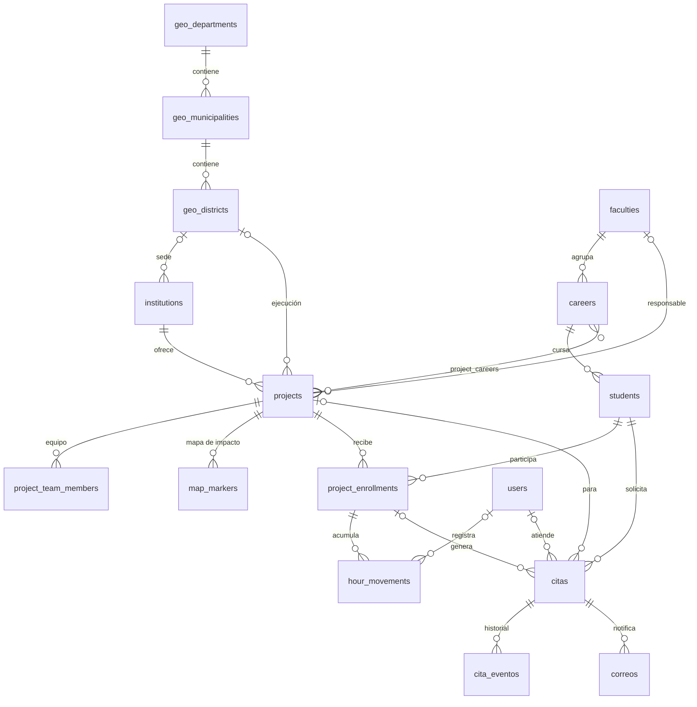

# horas-sociales-core-backend

Backend central de **Horas Sociales UCA**. Reúne en **una sola base de datos PostgreSQL normalizada** los tres sistemas que antes estaban separados:

| Sistema de origen | Qué aportaba | Dónde vive ahora |
|---|---|---|
| **Aplicativo de citas** | estudiantes, carreras, proyectos, citas, eventos, correos, días bloqueados, campos dinámicos, auditoría | `students`, `careers`, `projects`, `citas`, `cita_eventos`, `correos`, `dias_bloqueados`, `project_fields`, `auditoria` |
| **DER núcleo de horas sociales** | facultad, geografía (departamento > municipio > distrito), participación, movimiento de horas, administrador | `faculties`, `geo_*`, `project_enrollments`, `hour_movements`, `users` |
| **Portal / mapa de impacto** | instituciones, proyectos enriquecidos, inscripciones, marcadores del mapa | `institutions`, `projects`, `project_careers`, `project_team_members`, `map_markers` |

> **Stack:** Node.js ≥ 20 · TypeScript (ESM) · Express 5 · Sequelize 6 (sin `sync`) · PostgreSQL 16 · Zod · pnpm · tsx · Docker Compose

---

## Contenido

1. [Inicio rápido](#1-inicio-rápido)
2. [Scripts de pnpm](#2-scripts-de-pnpm)
3. [Estructura del proyecto](#3-estructura-del-proyecto)
4. [Arquitectura modular](#4-arquitectura-modular)
5. [Base de datos unificada](#5-base-de-datos-unificada)
6. [Migraciones](#6-migraciones)
7. [Docker](#7-docker)
8. [Variables de entorno](#8-variables-de-entorno)
9. [API: módulo `students`](#9-api-módulo-students)
10. [Convenciones de código](#10-convenciones-de-código)
11. [Solución de problemas](#11-solución-de-problemas)
12. [Próximos pasos](#12-próximos-pasos)

---

## 1. Inicio rápido

**Requisitos previos:** Node.js 20.11 o superior, pnpm 9 o superior (`corepack enable`) y Docker con Compose v2.

```bash
# 1. Dependencias
pnpm install

# 2. Variables de entorno
cp .env.example .env
#    Edite .env: DB_PASSWORD y las dos claves DUI_* (los comandos para generarlas están en el archivo)

# 3. Base de datos. El primer arranque crea el esquema completo automáticamente.
pnpm docker:up

# 4. Registrar la línea base y aplicar las migraciones pendientes
pnpm db:migrate

# 5. Servidor en modo desarrollo (recarga automática)
pnpm dev
```

Verificación:

```bash
curl http://localhost:3000/api/v1/health
# {"status":"ok","database":"up","timestamp":"..."}
```

> El contenedor publica PostgreSQL en el puerto **5434** del host para no chocar con otras instancias locales en 5432 o 5433. Si necesita otro puerto, cambie `DB_PORT` en `.env`.

---

## 2. Scripts de pnpm

| Script | Qué hace |
|---|---|
| `pnpm dev` | Ejecuta `src/main.ts` con `tsx watch` (sin compilar y con recarga automática) |
| `pnpm build` | Limpia `dist/` y compila con `tsc` |
| `pnpm start` | Ejecuta la versión compilada (`dist/main.js`), para producción |
| `pnpm typecheck` | Revisa los tipos sin generar archivos (útil en CI) |
| `pnpm db:migrate` | Aplica las migraciones SQL pendientes |
| `pnpm db:migrate:status` | Muestra una tabla con el estado de cada migración |
| `pnpm db:migrate:new <nombre>` | Crea `NNN_<nombre>.sql` a partir de la plantilla |
| `pnpm db:migrate:prod` | Igual que `db:migrate`, pero desde `dist/` (sin tsx) |
| `pnpm docker:up` / `docker:down` | Inicia o detiene PostgreSQL |
| `pnpm docker:reset` | ⚠ **Borra el volumen** y vuelve a crear la BD desde cero |
| `pnpm docker:logs` | Muestra los logs de PostgreSQL |
| `pnpm docker:psql` | Abre una consola `psql` dentro del contenedor |

---

## 3. Estructura del proyecto

```
.
├── docker-compose.yml              # PostgreSQL 16; carga 001_*.sql en el primer arranque
├── .env.example                    # Plantilla de configuración (copiar a .env)
├── package.json                    # "type": "module", scripts de pnpm
├── tsconfig.json                   # NodeNext + strict + verbatimModuleSyntax
└── src/
    ├── main.ts                     # Punto de entrada: config → BD → HTTP → apagado ordenado
    ├── core/                       # Infraestructura compartida (sin lógica de negocio)
    │   ├── config/
    │   │   ├── env.ts              # Carga y valida .env con Zod (única fuente de process.env)
    │   │   └── database.ts         # Instancia Sequelize; sync() bloqueado
    │   ├── server/
    │   │   ├── app.ts              # Fábrica de Express (helmet, cors, json, rutas, errores)
    │   │   ├── routes.ts           # Registro central: aquí se montan los módulos
    │   │   └── middlewares/        # error-handler, not-found, request-logger
    │   ├── errors/app-error.ts     # Errores de dominio con status HTTP
    │   ├── security/crypto.ts      # HMAC + AES-256-GCM para el DUI
    │   ├── validation/zod-es.ts    # Mensajes de validación en español
    │   └── logger.ts               # Logger mínimo con niveles
    ├── database/
    │   ├── migrate.ts              # Runner estricto (up | status | new)
    │   └── migrations/
    │       └── 001_init_unified_schema.sql
    └── modules/                    # Un directorio por contexto de negocio
        ├── careers/models/         # Modelo de mapeo compartido
        └── students/
            ├── index.ts            # API pública del módulo
            ├── routes/             # URL → controlador
            ├── controllers/        # HTTP: valida y responde
            ├── services/           # Reglas de negocio y acceso a datos
            ├── schemas/            # Contratos Zod de entrada
            └── models/             # Mapeo Sequelize (solo lectura del esquema)
```

---

## 4. Arquitectura modular

### 4.1 Capas y flujo de una petición

```
HTTP ─► routes ─► controller ─► service ─► model (Sequelize) ─► PostgreSQL
                     │              │
                  schemas (Zod)   AppError ──► error-handler ──► JSON uniforme
```

| Capa | Responsabilidad | No debe |
|---|---|---|
| **routes/** | Asociar método y URL con una función del controlador | contener lógica |
| **controllers/** | Validar `params`, `query` y `body` con Zod, llamar al servicio y elegir el status HTTP | acceder a modelos o a SQL |
| **services/** | Reglas de negocio, transacciones, conversión a DTO y errores `AppError` | conocer `req` o `res` |
| **schemas/** | Contratos de entrada y tipos inferidos (`z.infer`) | contener lógica |
| **models/** | Mapear tablas existentes a clases TypeScript | crear o alterar tablas |

### 4.2 Reglas de dependencia

- `core/` no importa nada de `modules/`. La única excepción es `core/server/routes.ts`, que monta los routers.
- Un módulo usa otro **solo a través de su `index.ts`**, nunca importando sus archivos internos.
- Los modelos que comparten varios módulos (p. ej. `Career`) viven en su propio módulo y se importan desde ahí.
- Toda la configuración se lee de `core/config/env.ts`; nadie lee `process.env` directamente.

### 4.3 Manejo de errores

Express 5 propaga solo los errores de las funciones `async`, así que los controladores no necesitan `try/catch`. El middleware `error-handler.ts` convierte cada error en una respuesta con este formato:

```json
{ "error": { "code": "UNIQUE_VIOLATION", "message": "…", "details": { "fields": ["dui_hash"] } } }
```

| Origen | HTTP | `code` |
|---|---|---|
| Zod (entrada inválida) | 400 | `VALIDATION_ERROR` |
| JSON mal formado | 400 | `INVALID_JSON` |
| `AppError.notFound` | 404 | `NOT_FOUND` |
| PostgreSQL `UNIQUE` | 409 | `UNIQUE_VIOLATION` |
| PostgreSQL `FOREIGN KEY` | 409 | `FOREIGN_KEY_VIOLATION` |
| PostgreSQL `CHECK` o regla de trigger | 422 | `CHECK_VIOLATION` |
| Cualquier otro | 500 | `INTERNAL_ERROR` (los detalles solo se muestran fuera de producción) |

La respuesta nunca incluye valores de la BD (por ejemplo, el `DETAIL` de Postgres que repite el dato duplicado).

### 4.4 Cómo crear un módulo nuevo (ej. `projects`)

1. Si hace falta, cree la migración: `pnpm db:migrate:new crear_tabla_x`, escriba el SQL y ejecute `pnpm db:migrate`.
2. Cree `src/modules/projects/{models,schemas,services,controllers,routes}` siguiendo el patrón de `students`.
3. Exporte el router en `src/modules/projects/index.ts`.
4. Móntelo en `src/core/server/routes.ts` con `apiRouter.use('/projects', projectsRouter)`.
5. Ejecute `pnpm typecheck`.

> **Imports ESM:** las rutas relativas llevan extensión `.js` aunque el archivo sea `.ts` (`import { x } from './x.js'`), y los tipos se importan con `import type`. Así lo exigen `NodeNext` y `verbatimModuleSyntax`.

---

## 5. Base de datos unificada

### 5.1 Diagrama entidad-relación (resumen)



Tablas sin relaciones físicas: `project_fields` (valida `projects.atributos` JSONB), `dias_bloqueados` (los usa un trigger de `citas`), `auditoria` y `schema_migrations`.

### 5.2 Decisiones de unificación

| Conflicto entre sistemas | Resolución |
|---|---|
| IDs `bigint`, `integer`, `smallint`, `text` y `uuid` | **`uuid` en todas las tablas** (`gen_random_uuid()` de `pgcrypto`). Excepciones: `auditoria` (`bigint identity`, alto volumen) y `dias_bloqueados` (PK natural `fecha`). |
| `students.carrera text` o `facultad text` | FK reales: `students.career_id → careers` y `careers.faculty_id → faculties`. La facultad del estudiante se deriva de su carrera. |
| `nombre_completo` frente a `nombres` + `apellidos` | Se guardan `nombres` y `apellidos`; `nombre_completo` es una **columna generada**. |
| `projects.carreras text[]` y `team_members text[]` | Tablas puente `project_careers` y `project_team_members`. |
| `nombre_normalizado` mantenido a mano | Columna generada con `fn_normalize_text()` (minúsculas, sin tildes, espacios colapsados) y `UNIQUE` sobre ella. |
| `users` y `administrador` | Una sola tabla `users` con `rol` (`ADMIN`, `COORDINADOR`, `CONSULTA`) y `correo` `citext` único. |
| Inscripción frente a participación | `project_enrollments` con `estado` controlado y `UNIQUE (student_id, project_id)`. |
| Horas sin historial | `hour_movements` funciona como libro de movimientos (`horas > 0`, `naturaleza`, `solicitud_id` único para idempotencia). El saldo se lee en la vista `v_student_hours`. |
| La cita guardaba el nombre del proyecto y de la institución | `project_id` (FK `SET NULL`) **más** una copia de los nombres al momento de la cita (`proyecto_nombre`, `institucion_nombre`), para que el historial sobreviva si se borra el proyecto o para un proyecto propuesto que aún no está en el catálogo. |
| DUI en claro o con hash simple | `dui_hash` (HMAC-SHA256, `UNIQUE`) + `dui_cifrado` (AES-256-GCM). Ver §5.6. |

### 5.3 Política `ON DELETE`

| Relación | Acción | Motivo |
|---|---|---|
| `geo_departments → geo_municipalities → geo_districts` | `CASCADE` | Es un catálogo jerárquico: si se borra el padre, se borran los hijos |
| `institutions/projects/map_markers.district_id` | `SET NULL` | La ubicación es opcional |
| `projects.faculty_id` | `SET NULL` | La facultad responsable es opcional |
| `project_careers`, `project_team_members`, `map_markers` → `projects` | `CASCADE` | Son detalles que dependen del proyecto |
| `cita_eventos`, `correos` → `citas` | `CASCADE` | Son detalles que dependen de la cita |
| `citas.project_id`, `citas.career_id`, `citas.enrollment_id` | `SET NULL` | La copia textual conserva el historial |
| `*.registrado_por`, `atendido_por`, `creado_por`, `user_id` → `users` | `SET NULL` | Quitar a un administrador no borra los registros que hizo |
| `careers → faculties`, `students → careers`, `projects → institutions` | `RESTRICT` | Proteger el historial académico; **desactive** (`activo = false`) en lugar de borrar |
| `project_enrollments → students/projects`, `hour_movements → project_enrollments`, `citas → students` | `RESTRICT` | Las horas y las citas son historial que no debe perderse |

### 5.4 Reglas de negocio en la base de datos

Las reglas críticas viven en PostgreSQL, así que se cumplen sin importar qué aplicación escriba los datos.

- **`CHECK`**: formato del carnet (8 dígitos), correo `@uca.edu.sv`, `genero ∈ {HOMBRE, MUJER}`, fechas coherentes, cupos > 0, coordenadas válidas, y estados coherentes con sus fechas (p. ej. `CANCELADA ⇔ cancelado_en`, `FINALIZADA ⇔ asistencia registrada`, `CONFIRMADA ⇒ fecha_hora`).
- **Índice único parcial `uq_citas_student_abierta`**: cada estudiante puede tener **una sola cita abierta** (`SOLICITADA`, `CONFIRMADA` o `REPROGRAMADA`).
- **Trigger `fn_citas_validar_dia_bloqueado`**: impide agendar en un día de `dias_bloqueados` (usa la hora de `America/El_Salvador`).
- **Trigger `fn_citas_registrar_evento`**: escribe en `cita_eventos` al crear una cita y cuando cambia su estado o su fecha.
- **`citas.codigo`**: se genera solo, con el formato `CITA-2026-000123` (secuencia propia).

### 5.5 Triggers transversales

| Trigger | Tablas | Qué hace |
|---|---|---|
| `trg_<tabla>_updated_at` | todas las que tienen `updated_at` | `fn_set_updated_at()` actualiza la columna en cada `UPDATE` |
| `trg_<tabla>_auditoria` | `faculties`, `careers`, `users`, `students`, `institutions`, `projects`, `project_fields`, `project_enrollments`, `hour_movements`, `citas`, `dias_bloqueados` | `fn_auditoria()` guarda antes y después como JSONB en `auditoria` |

En la auditoría:

- Las columnas `dui_hash`, `dui_cifrado` y `password_hash` **nunca se copian**.
- Un `UPDATE` que no cambia nada (salvo `updated_at`) no genera registro.
- El **actor** sale de `current_setting('app.actor')`. Para atribuir un cambio a un usuario, ejecute dentro de la transacción:

```ts
await sequelize.transaction(async (t) => {
  await sequelize.query(`SELECT set_config('app.actor', :actor, true)`, {
    replacements: { actor: `user:${userId}` },
    transaction: t,
  });
  // ... operaciones auditadas ...
});
```

Si no se define, se registra el usuario de PostgreSQL.

### 5.6 Datos sensibles: DUI

- La API recibe el DUI en claro (`01234567-8` o `012345678`) y **nunca lo devuelve**. Solo expone `duiRegistrado: boolean`.
- `dui_hash = HMAC-SHA256(dui, DUI_HASH_KEY)` se usa para la unicidad y la búsqueda exacta.
- `dui_cifrado = AES-256-GCM(dui, DUI_ENCRYPTION_KEY)` permite recuperarlo cuando haga falta (`decryptDui()` en `core/security/crypto.ts`).
- ⚠ **No cambie las claves** si ya hay datos: perderá la unicidad y la capacidad de descifrar. Rotarlas requiere una migración de datos planificada.

### 5.7 Vistas

| Vista | Uso |
|---|---|
| `v_student_hours` | Saldo por estudiante: `horas_internas`, `horas_externas`, `horas_totales`, `participaciones` |

---

## 6. Migraciones

### 6.1 Principios

- **El esquema solo cambia con archivos SQL** en `src/database/migrations/`. `sequelize.sync()` está **bloqueado** y lanza un error si alguien lo llama.
- Los modelos de Sequelize **reflejan** el esquema; no lo definen.
- Cada migración corre en **su propia transacción** con un *advisory lock*, de modo que dos despliegues simultáneos no la aplican dos veces.
- El runner guarda el **SHA-256** de cada archivo en `schema_migrations`. Si un archivo ya aplicado cambia, **el runner se niega a continuar**.
- **No hay `down`.** Para revertir un cambio se escribe otra migración que lo deshaga.

### 6.2 Flujo de trabajo

```bash
# 1. Crear el archivo con la plantilla (el número se asigna solo)
pnpm db:migrate:new agregar_campo_horas_requeridas
#    → src/database/migrations/002_agregar_campo_horas_requeridas.sql

# 2. Escribir el SQL (sin BEGIN/COMMIT; el runner abre la transacción)

# 3. Aplicar y verificar
pnpm db:migrate
pnpm db:migrate:status

# 4. Actualizar el modelo de Sequelize y el código del módulo
# 5. Commit del .sql y del código en el mismo PR
```

Ejemplo de una migración `002`:

```sql
ALTER TABLE projects ADD COLUMN horas_requeridas integer;
ALTER TABLE projects ADD CONSTRAINT ck_projects_horas_requeridas
    CHECK (horas_requeridas IS NULL OR horas_requeridas > 0);
```

### 6.3 Reglas

| ✅ Hacer | ❌ No hacer |
|---|---|
| Nombres con el formato `NNN_descripcion_snake.sql` (al menos 3 dígitos) | Editar un `.sql` que ya se aplicó en un entorno compartido |
| Nombrar las restricciones de forma explícita (`fk_`, `uq_`, `ck_`, `ix_`) | Incluir `BEGIN` o `COMMIT` en el archivo |
| Agregar el trigger `updated_at` a cada tabla nueva que lo tenga | Usar `sequelize.sync()` o `queryInterface` |
| Escribir migraciones compatibles hacia atrás (agregar → migrar datos → restringir) | Borrar una columna en uso en el mismo despliegue que deja de usarla |
| Ejecutar `pnpm db:migrate:status` antes de abrir un PR | Renumerar archivos ya aplicados |

> `CREATE INDEX CONCURRENTLY` no puede correr dentro de una transacción. En tablas grandes de producción, ejecútelo a mano y documéntelo en una migración con `CREATE INDEX IF NOT EXISTS`.

### 6.4 Docker y la línea base

En el primer arranque del contenedor (volumen vacío), PostgreSQL ejecuta `001_init_unified_schema.sql` desde `/docker-entrypoint-initdb.d`. Al final del script, la migración se registra a sí misma en `schema_migrations` con `checksum = NULL`. La siguiente vez que corre `pnpm db:migrate`:

```
↺ 001_init_unified_schema.sql (línea base registrada por Docker: checksum adoptado)
```

Desde ese momento queda protegida por el checksum como cualquier otra migración. Las migraciones `002+` **no** se montan en Docker y siempre se aplican con `pnpm db:migrate`.

En un servidor sin Docker (RDS, Azure, etc.), basta con ejecutar `pnpm db:migrate` sobre una BD vacía: el runner aplica `001` en una transacción.

### 6.5 Estados en `db:migrate:status`

| Estado | Significado |
|---|---|
| `APLICADA` | Aplicada y con el checksum correcto |
| `APLICADA (línea base, sin checksum)` | La registró Docker; se adopta en el próximo `db:migrate` |
| `PENDIENTE` | Aún no se aplicó |
| `MODIFICADA ⚠` | El archivo cambió después de aplicarse; restaure el original |
| `HUÉRFANA ⚠` | Está registrada en la BD pero el archivo ya no existe |

---

## 7. Docker

```bash
pnpm docker:up        # inicia PostgreSQL (hs-core-db) con el volumen hs-core-pgdata
pnpm docker:logs      # ver logs
pnpm docker:psql      # consola SQL
pnpm docker:down      # detener (los datos se conservan)
pnpm docker:reset     # ⚠ borrar los datos y volver a crear el esquema desde 001
```

- Las credenciales se leen de `.env` (`DB_NAME`, `DB_USER`, `DB_PASSWORD`, `DB_PORT`).
- El contenedor trabaja con la zona horaria `America/El_Salvador`. Las columnas `timestamptz` se guardan en UTC.
- El *healthcheck* usa `pg_isready`; espere el estado `healthy` antes de migrar.
- **Los scripts de `/docker-entrypoint-initdb.d` solo se ejecutan con el volumen vacío.** Si cambia `001` en desarrollo local antes de compartirlo, use `pnpm docker:reset`.

---

## 8. Variables de entorno

| Variable | Requerida | Por defecto | Descripción |
|---|---|---|---|
| `NODE_ENV` | no | `development` | `development`, `test` o `production` |
| `PORT` | no | `3000` | Puerto HTTP |
| `API_PREFIX` | no | `/api/v1` | Prefijo de todas las rutas |
| `CORS_ORIGINS` | no | `*` | Orígenes permitidos, separados por coma |
| `LOG_LEVEL` | no | `info` | `debug`, `info`, `warn` o `error` |
| `DB_HOST` | **sí** | — | Host de PostgreSQL |
| `DB_PORT` | no | `5432` | Puerto (el `.env.example` usa `5434`) |
| `DB_NAME` / `DB_USER` / `DB_PASSWORD` | **sí** | — | Credenciales de la BD |
| `DB_POOL_MAX` | no | `10` | Máximo de conexiones en el pool |
| `DB_LOGGING` | no | `false` | Imprime el SQL de Sequelize (con `LOG_LEVEL=debug`) |
| `DB_SSL` | no | `false` | Activa TLS para BD administradas |
| `DB_SSL_REJECT_UNAUTHORIZED` | no | `true` | Validar el certificado del servidor |
| `DUI_HASH_KEY` | **sí (API)** | — | Clave HMAC de 32 caracteres o más |
| `DUI_ENCRYPTION_KEY` | **sí (API)** | — | 64 caracteres hexadecimales (32 bytes) para AES-256 |

`env.ts` valida todas las variables al arrancar; si alguna es inválida, el proceso termina con un mensaje claro. Las claves `DUI_*` no son necesarias para `db:migrate`, pero el servidor no arranca sin ellas.

---

## 9. API: módulo `students`

Base: `http://localhost:3000/api/v1/students`

| Método | Ruta | Descripción | Respuestas |
|---|---|---|---|
| `GET` | `/` | Lista paginada. Query: `page`, `pageSize` (≤ 100), `q`, `careerId`, `activo` | 200 |
| `GET` | `/:id` | Detalle del estudiante | 200, 404 |
| `GET` | `/:id/hours` | Saldo de horas sociales | 200, 404 |
| `POST` | `/` | Crear un estudiante | 201, 400, 409, 422 |
| `PATCH` | `/:id` | Actualización parcial (`"dui": null` borra el DUI) | 200, 400, 404, 409, 422 |
| `DELETE` | `/:id` | Eliminar | 204, 404, 409 (tiene historial: desactívelo) |

`q` busca en el nombre completo **sin distinguir mayúsculas ni tildes** (`lopez` encuentra «López»), y también en el carnet y el correo.

**Crear:**

```bash
curl -X POST http://localhost:3000/api/v1/students \
  -H 'Content-Type: application/json' \
  -d '{
        "carnet": "00012345",
        "nombres": "Ana María",
        "apellidos": "López Pérez",
        "correoInstitucional": "00012345@uca.edu.sv",
        "genero": "MUJER",
        "careerId": "<uuid de careers>",
        "dui": "01234567-8"
      }'
```

```json
{
  "data": {
    "id": "25ed4557-…",
    "carnet": "00012345",
    "nombreCompleto": "Ana María López Pérez",
    "correoInstitucional": "00012345@uca.edu.sv",
    "genero": "MUJER",
    "duiRegistrado": true,
    "activo": true,
    "career": { "id": "…", "nombre": "Ingeniería Informática", "facultyId": "…" },
    "createdAt": "…",
    "updatedAt": "…"
  }
}
```

**Listar:**

```bash
curl 'http://localhost:3000/api/v1/students?q=lopez&page=1&pageSize=20'
# { "data": [ ... ], "meta": { "page": 1, "pageSize": 20, "total": 1, "totalPages": 1 } }
```

Para probar con datos, primero cree una facultad y una carrera (aún no tienen endpoint):

```sql
WITH f AS (INSERT INTO faculties (nombre) VALUES ('Ingeniería y Arquitectura') RETURNING id)
INSERT INTO careers (faculty_id, nombre) SELECT id, 'Ingeniería Informática' FROM f RETURNING id;
```

---

## 10. Convenciones de código

- **Nombres:** las columnas usan `snake_case` y las propiedades TypeScript y JSON usan `camelCase`. Sequelize traduce entre ambos (`underscored: true`).
- **Idioma:** los nombres de dominio siguen el vocabulario de la UCA (`carnet`, `citas`, `horas`). Las tablas núcleo heredadas del portal se mantienen en inglés (`students`, `projects`).
- **Archivos:** `kebab-case` con sufijo por capa: `students.controller.ts`, `students.service.ts`, `student.model.ts`, `student.schemas.ts`.
- **Respuestas:** un objeto va en `{ data }`, una lista en `{ data, meta }` y un error en `{ error }`.
- **Validación doble:** Zod da mensajes claros al cliente y los `CHECK` de PostgreSQL son la última barrera. Si cambia una regla, actualice **ambos**.
- **Columnas generadas** (`nombre_completo`, `nombre_normalizado`): son de solo lectura y no se asignan desde el código.
- **DTOs:** los servicios nunca devuelven instancias de Sequelize; siempre las convierten a un DTO explícito.

---

## 11. Solución de problemas

| Síntoma | Causa probable y solución |
|---|---|
| `Bind for 0.0.0.0:5434 failed: port is already allocated` | Otro proceso usa el puerto. Cambie `DB_PORT` en `.env` y ejecute `pnpm docker:up` |
| `❌ Variables de entorno inválidas` | Falta `.env` o un valor tiene un formato incorrecto. Compárelo con `.env.example` |
| `Faltan DUI_HASH_KEY y/o DUI_ENCRYPTION_KEY` | Genere las claves con los comandos indicados en `.env.example` |
| `Integridad de migraciones comprometida … MODIFICADA` | Se editó un `.sql` aplicado. Restáurelo (`git checkout`) y cree una migración nueva |
| `relation "students" does not exist` | No se aplicó el esquema. Ejecute `pnpm db:migrate`, o `pnpm docker:reset` si es local |
| Se cambió `001` pero Docker no lo vuelve a ejecutar | Docker init solo corre con el volumen vacío. Use `pnpm docker:reset` (solo en local) |
| `sequelize.sync() está deshabilitado` | Es intencional. Cree una migración |
| `ERR_MODULE_NOT_FOUND` con un import relativo | Falta la extensión `.js` en el import |
| `La fecha … está bloqueada para citas` (422) | La fecha está en `dias_bloqueados` con `bloqueado = true` |

---

## 12. Próximos pasos

- [ ] Módulo `auth` (login de `users`, JWT, middleware de roles y fijar `app.actor` por petición).
- [ ] Módulo `catalogs`: CRUD de `faculties`, `careers` y la geografía, más un *seed* de departamentos, municipios y distritos de El Salvador.
- [ ] Módulos `institutions` y `projects`, incluida la validación de `atributos` contra `project_fields`.
- [ ] Módulo `citas`: flujo de estados, *worker* de la bandeja de `correos` y recordatorios.
- [ ] Módulo `hours`: registro de `hour_movements` con idempotencia por `solicitud_id`.
- [ ] Pruebas (Vitest + Supertest con un PostgreSQL efímero) y pipeline de CI (`typecheck`, `build`, `db:migrate` sobre una BD vacía).
- [ ] Script de migración de datos desde los tres sistemas anteriores.
